# Intranuit pour votre chronique

Présentation des fonctionnalités et guide d’installation sur GitHub Pages et Firebase

Version du 31 octobre 2026 · © 2026 Swiiptz · Intranuit

Intranuit rassemble les actions entre deux parties d’une chronique de Vampire : la Mascarade. Les joueurs déposent leurs AIP et leurs influences ; les conteurs les répartissent, les traitent et diffusent les résultats. Chaque association peut exploiter une instance indépendante, avec ses comptes, ses personnages et ses archives.

Ce guide présente le fonctionnement actuel, ses spécificités et la procédure d’installation d’une nouvelle instance. La première partie s’adresse aux responsables associatifs et aux conteurs. La dernière accompagne la personne chargée de la mise en ligne, avec des étapes dans les consoles GitHub et Firebase.

**État de la proposition.** Le socle fonctionne en local et ses compilations origine et réplicable ont été vérifiées. La distribution publique et l’installation complète sur un nouveau projet restent à finaliser et à recetter. La procédure ci-dessous décrit cette installation ; elle ne signifie pas qu’une instance a déjà été créée pour votre association.

Les illustrations utilisent des personnages et des comptes fictifs de démonstration. « Melun » est l’identité de l’instance montrée. Certaines captures de la console d’origine affichent un onglet Oracle : il est absent de la compilation réplicable, avec les écrans qu’il contient.

## 1 Une vue commune entre deux parties

Le joueur retrouve son personnage, le cycle en cours et deux dossiers distincts : ses actions inter-parties et ses influences. Il peut consulter ses anciens résultats et suivre ses demandes de progression depuis le même espace.

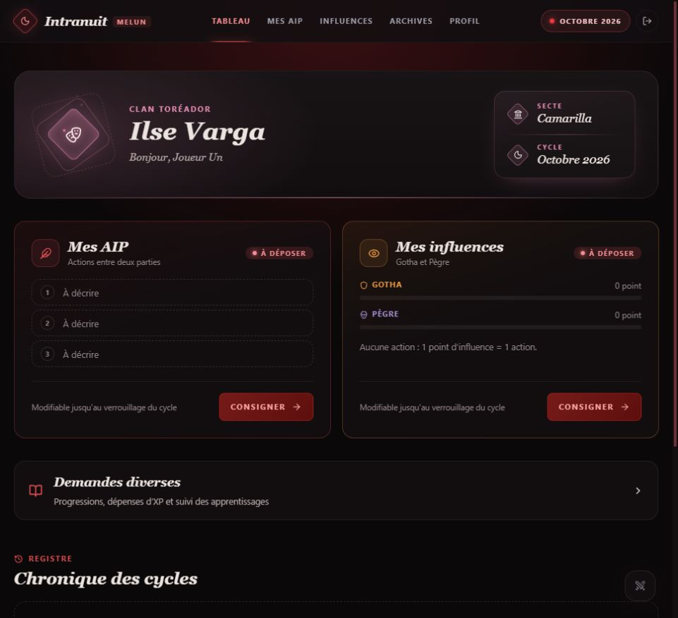

*Figure 1 — Le tableau de bord indique les dossiers à déposer et donne accès aux demandes diverses et aux archives.*

Le parcours habituel d’un cycle tient en cinq étapes :

1. L’équipe ouvre le cycle et indique, si nécessaire, une date limite.
2. Les joueurs déposent leurs AIP, leurs influences et leurs éventuelles demandes de progression.
3. Les conteurs verrouillent les dossiers, répartissent les actions et préparent les réponses.
4. L’équipe relit les résultats, les rumeurs, les dépenses et les décisions d’apprentissage.
5. La diffusion rend les résultats visibles dans l’interface joueur et ouvre le cycle suivant.

Le rythme peut être mensuel ou bimestriel. Un cycle peut être suspendu ou un mois sauté. La date limite affichée n’entraîne pas de verrouillage automatique : celui-ci reste une décision de l’équipe.

## 2 Les accès de chaque rôle

| Rôle | Accès et responsabilités |
| --- | --- |
| Compte en attente | Attend la validation de l’administration ; aucun accès aux dossiers de jeu. |
| Joueur | Renseigne son profil, dépose ses dossiers, suit ses demandes et consulte ses archives. |
| Conteur | Consulte et traite les dossiers de la chronique, gère les PNJ, les réseaux, les rumeurs, les apprentissages et les cycles. |
| Administrateur | Dispose des accès conteur et gère les comptes, les rôles et l’identité de la chronique. |

L’inscription utilise une adresse e-mail et un mot de passe. La validation d’un compte par un administrateur est distincte de la vérification de l’adresse e-mail : **l’application n’envoie actuellement aucun mail de vérification à l’inscription**. La récupération de mot de passe utilise Firebase Authentication.

Les joueurs n’ont pas accès aux dossiers des autres joueurs. Les membres peuvent toutefois voir l’annuaire des personnages proposé dans « Avec qui », y compris les PNJ déclarés connus des joueurs.

## 3 La fiche du personnage et ses archives

Le profil regroupe le pseudo du joueur, le nom du personnage, son clan, son allégeance, ses niveaux et spécialités Gotha/Pègre, ses bonus d’AIP, son Troupeau et des scores utiles pour ses actions. Ces informations servent à préremplir les formulaires.

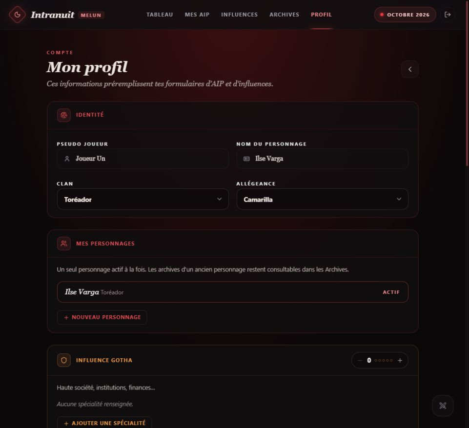

*Figure 2 — La fiche est déclarative. Elle aide à saisir les actions et ne remplace pas la validation de la feuille de personnage par les conteurs.*

Un compte conserve plusieurs personnages dans son historique, avec **un seul personnage actif à la fois**. Créer un nouveau personnage conserve les dossiers des précédents. Les archives permettent de choisir le personnage et l’année. Un administrateur peut réactiver un ancien personnage ; l’annuaire peut nécessiter sa reconnexion pour se mettre à jour.

## 4 Les AIP et les dépenses du personnage

Le formulaire prévoit trois actions principales et les actions bonus déclarées dans la fiche. Pour chaque action, le joueur indique son type, le lieu, son texte et, s’il le souhaite, les personnages impliqués et le score utilisé. Informatique, champs de Sciences et autres bonus nommés disposent de leurs entrées.

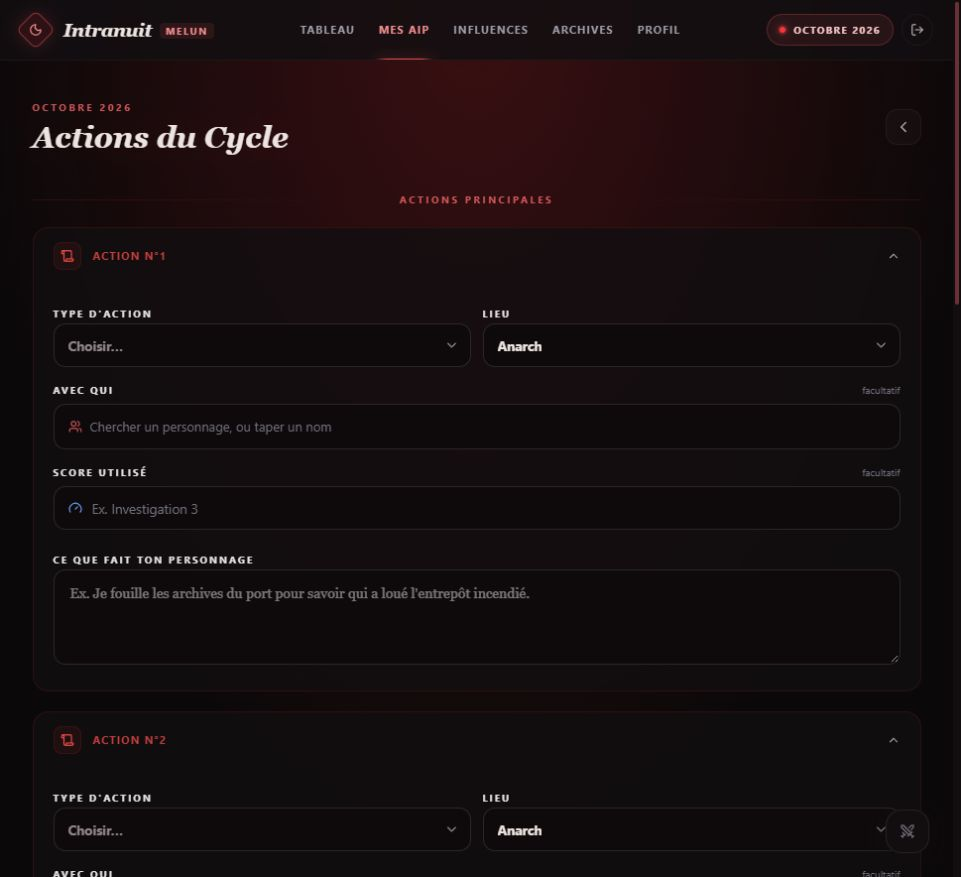

*Figure 3 — Les actions se décrivent séparément. La chasse n’est pas préremplie et aucun rappel ne contraint le joueur à la déclarer.*

L’enregistrement est explicite : il n’existe pas de brouillon automatique. Un dossier déposé reste modifiable avant son verrouillage. Après verrouillage, le joueur passe en consultation.

La supervision Sang aide les conteurs à résoudre la chasse et à suivre la réserve après traitement. Un emprunt facultatif de Troupeau peut être déclaré dans une section repliable du formulaire. Le joueur ne reçoit ni rappel de chasse manquante ni prévision de réserve avant diffusion ; les conteurs conservent la main sur la résolution.

Les dépenses d’argent du personnage sont saisies avec un montant et un motif. Un conteur valide la dépense ou la refuse avec une justification. Le total déclaré et le total validé sont distincts. Modifier le montant ou le motif remet l’avis en attente. Ce suivi ne tient aucun portefeuille ni solde automatique et ne concerne pas les XP.

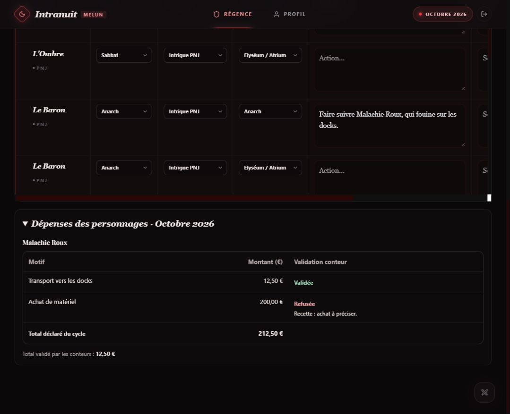

*Figure 4 — Exemple de recette : 212,50 € déclarés, dont 12,50 € validés. Le refus de 200 € reste visible avec son motif.*

## 5 Le travail collectif des conteurs

La Régence présente les AIP dans un tableau éditable commun aux PJ et aux PNJ actifs. Recherche, filtres, attribution à un conteur, filtre « À moi » et sélection groupée servent à répartir le travail. Les actions impliquant les mêmes acteurs peuvent être regroupées.

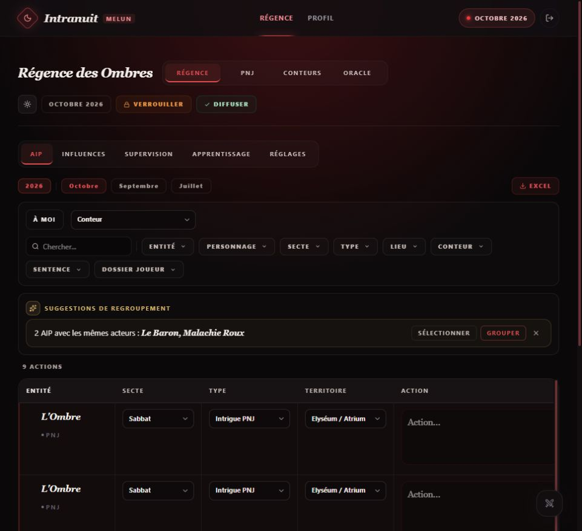

*Figure 5 — Le traitement se fait dans le tableau existant. Sur une fenêtre étroite, les colonnes se parcourent horizontalement.*

Les conteurs rédigent les réponses dans le tableau ou dans un champ agrandi, avec aperçu. Les PNJ ont leurs propres actions et bonus. Aucun compteur de charge individuelle n’est imposé à l’équipe.

**Diffusion.** Les réponses manquantes des joueurs déclenchent un avertissement ; les PNJ sans réponse ne sont pas comptés dans cet avertissement. La diffusion termine les dossiers concernés et avance le cycle selon le rythme choisi. Elle doit être précédée d’une relecture de l’équipe.

## 6 Les influences Gotha et Pègre

Les influences sont séparées en deux catégories, Gotha et Pègre. Le joueur décrit l’action, le niveau de base, les actions dépensées, la spécialité et le réseau ou la cible. Le catalogue distingue les actions globales et les actions ciblées, dont attaque, défense, soutien et obstruction.

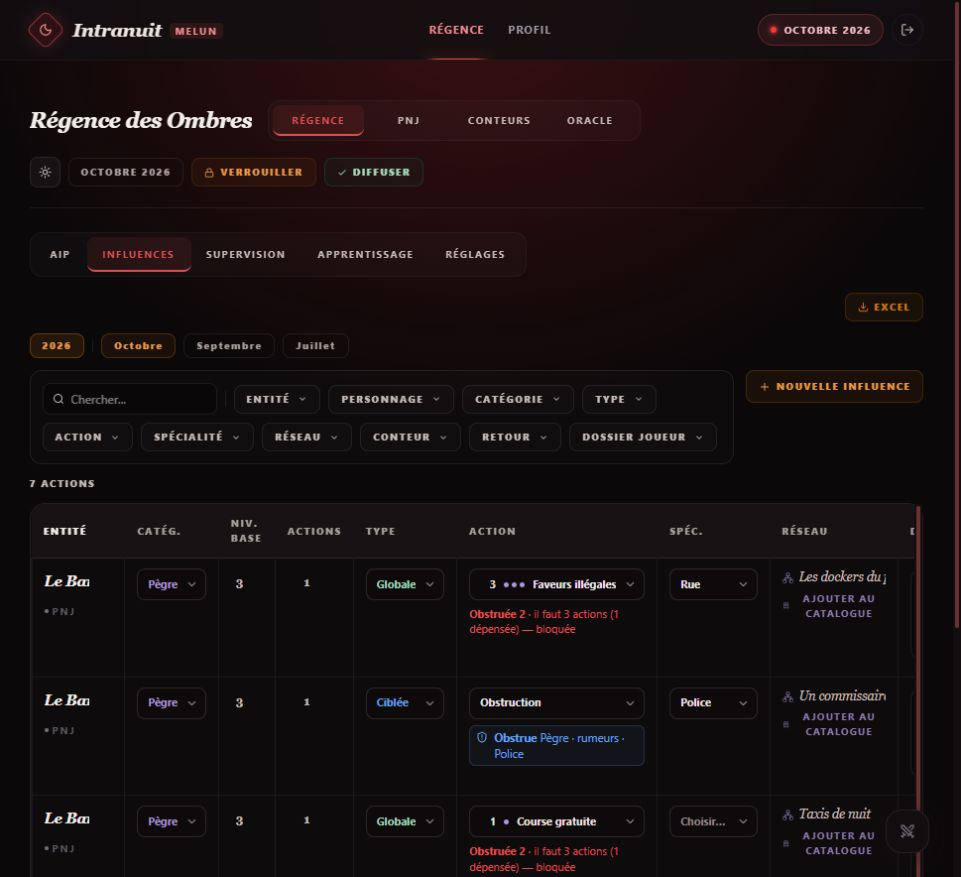

*Figure 6 — La console rassemble les influences des PJ et PNJ. Les calculs affichés accompagnent la résolution et les décisions du conteur.*

La supervision aide à examiner les défenses, les attaques, les obstructions, les soutiens et les niveaux effectifs. Les pertes d’influence sont suivies avec leurs dates de fin. Un catalogue de réseaux permet de conserver les institutions et contacts de la chronique.

**Spécificités à connaître.** Le profil reste déclaratif. Il n’existe pas de contrôle automatique complet du budget d’actions d’influence. La pertinence d’une spécialité, les conditions narratives d’une attaque, les districts et les effets particuliers restent à l’appréciation des conteurs. La défense tardive n’est pas vérifiée par chronologie ; la politique de grâce doit être gérée par l’équipe.

### Les obstructions par activité

Une obstruction précise la catégorie affectée et l’activité visée. La catégorie affectée peut différer de celle utilisée pour agir. Pour une activité décrite librement, le conteur relie manuellement les tentatives concernées dans Supervision, puis Résolution. L’application ne décide pas du sens d’un texte à partir de son seul intitulé.

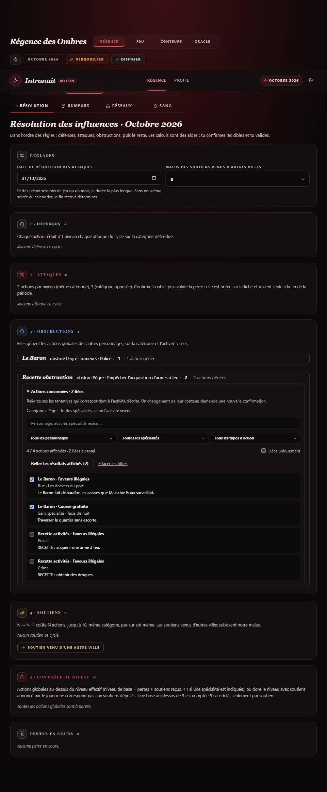

*Figure 7 — Recherche, filtres et liaison groupée facilitent la sélection. Les cases visibles sont un état de démonstration, pas un exemple d’arbitrage à reproduire.*

La recherche porte sur le personnage, l’activité, la spécialité, le réseau et le texte complet. Les filtres peuvent être combinés. « Relier les résultats affichés » ajoute les liens manquants sans effacer les autres. Les descriptions longues peuvent être dépliées indépendamment des cases.

Un changement du contenu d’une activité invalide la correspondance et demande une nouvelle confirmation. Modifier sa réponse ou le nombre d’actions dépensées conserve le lien. L’application calcule ensuite le cumul et indique le surcoût : **une obstruction de niveau 2 exige trois actions pour accomplir l’activité**. Elle ne compare pas le niveau du catalogue au niveau de l’obstruction. Les propres actions du personnage et les actions ciblées sont exclues.

### Les rumeurs et leur relecture

Les actions La Rumeur et Potins alimentent des tableaux par catégorie et spécialité sur le mois courant et les deux mois joués précédents ; un mois sans cycle ne compte pas. Le joueur doit avoir des spécialités déclarées dans le profil pour soumettre une action de rumeur de cette catégorie. Les obstructions de rumeurs conservent un choix structuré : une spécialité ou l’ensemble des spécialités.

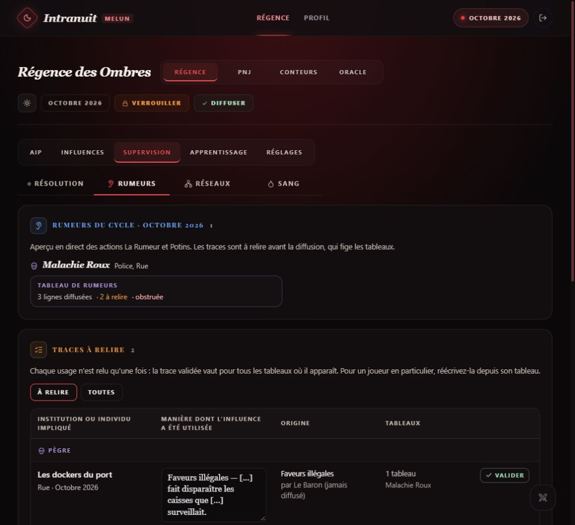

*Figure 8 — Une trace commune peut servir à plusieurs destinataires ; une formulation personnelle peut être préparée dans le tableau d’un joueur.*

Les conteurs peuvent masquer, corriger ou compléter les lignes et consulter leur aperçu. Les tableaux sont figés pour la diffusion. Une obstruction sur l’acquisition d’armes ne bloque pas automatiquement une récolte de rumeurs Police.

**Relecture nécessaire.** L’anonymisation automatique ne garantit pas l’absence d’identité dans toutes les colonnes, notamment le nom d’un réseau ou d’une institution. Les ajouts manuels demandent également une vérification humaine de leur cohérence avec les obstructions. Les usages propres sont encore exclus au niveau du compte entier dans cette logique de rumeurs.

## 7 Les apprentissages et les progressions

Une AIP de type Apprentissage porte une demande d’apprentissage. Les demandes diverses permettent de proposer une progression de compétence, d’attribut ou de discipline avec une explication. Les deux sources rejoignent la même file de traitement côté conteur.

Le conteur valide ou refuse, motive sa décision et peut conserver des notes internes privées. Le joueur retrouve ses décisions et ses acquisitions. Une AIP correspond à un apprentissage ; aucun coût ni solde d’XP n’est calculé. Une demande diverse déposée n’est pas modifiable dans cette version.

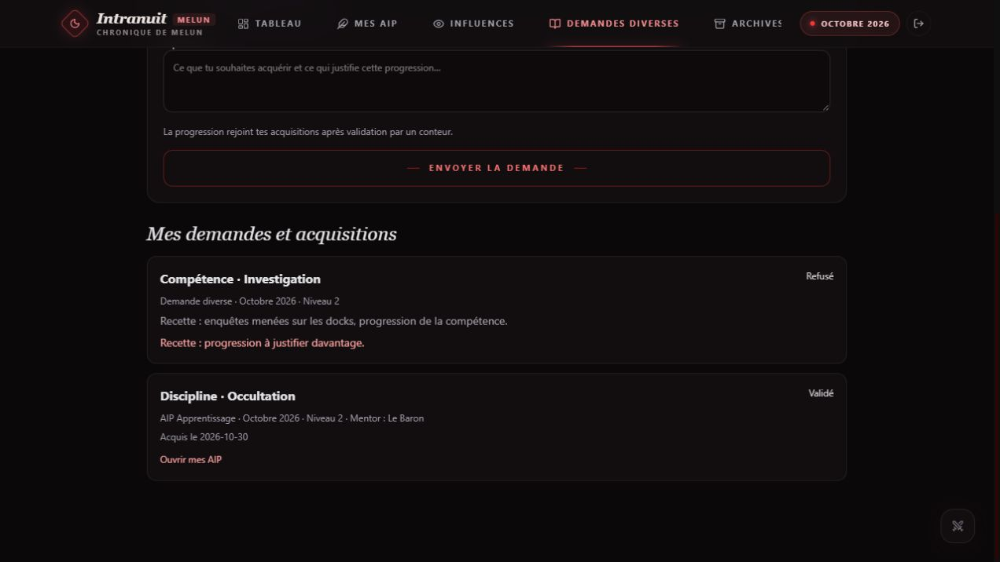

*Figure 9 — Exemple de recette : progression refusée et apprentissage validé. L’accès actuel se fait depuis « Demandes diverses » sous les cartes du tableau de bord ; cette capture antérieure montre encore l’ancien onglet.*

## 8 Les PNJ et l’organisation de la chronique

Une fiche PNJ contient identité, concept, notes, conteur responsable, influences et bonus d’AIP. Les statuts permettent de conserver les personnages actifs, en sommeil, morts ou disparus. La visibilité dans l’annuaire joueur est distincte de l’activité du PNJ.

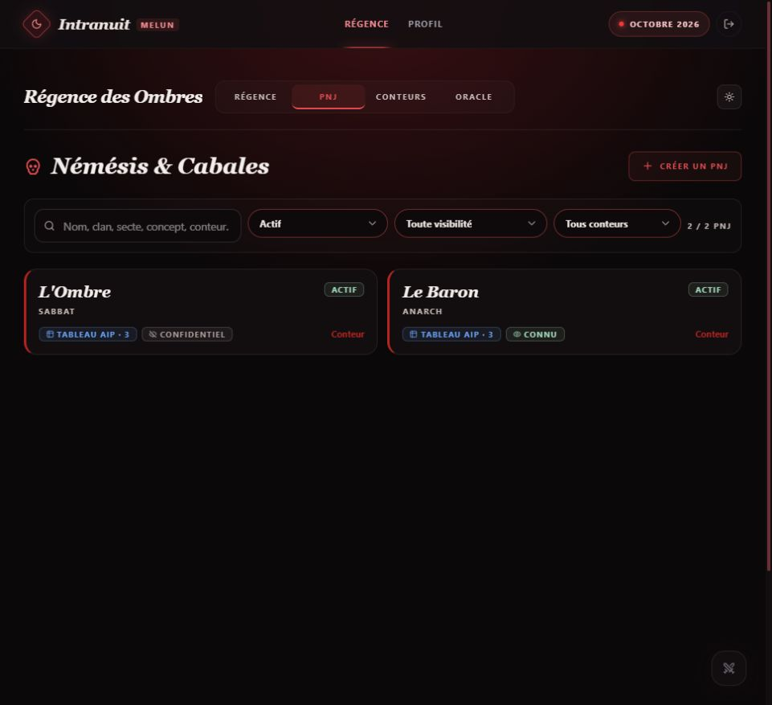

*Figure 10 — Un PNJ peut être actif dans le traitement conteur tout en restant confidentiel pour les joueurs.*

Les PNJ actifs participent au tableau AIP et à l’export conteur. Leurs historiques sont conservés. L’équipe dispose aussi d’une liste de conteurs avec couleurs d’attribution.

Les cycles, les lieux et les types d’AIP se règlent dans la Régence. Les lieux d’exemple doivent être adaptés à votre chronique. Les types « Se nourrir » et « Apprentissage » sont protégés car ils ont un rôle dans le fonctionnement de l’application.

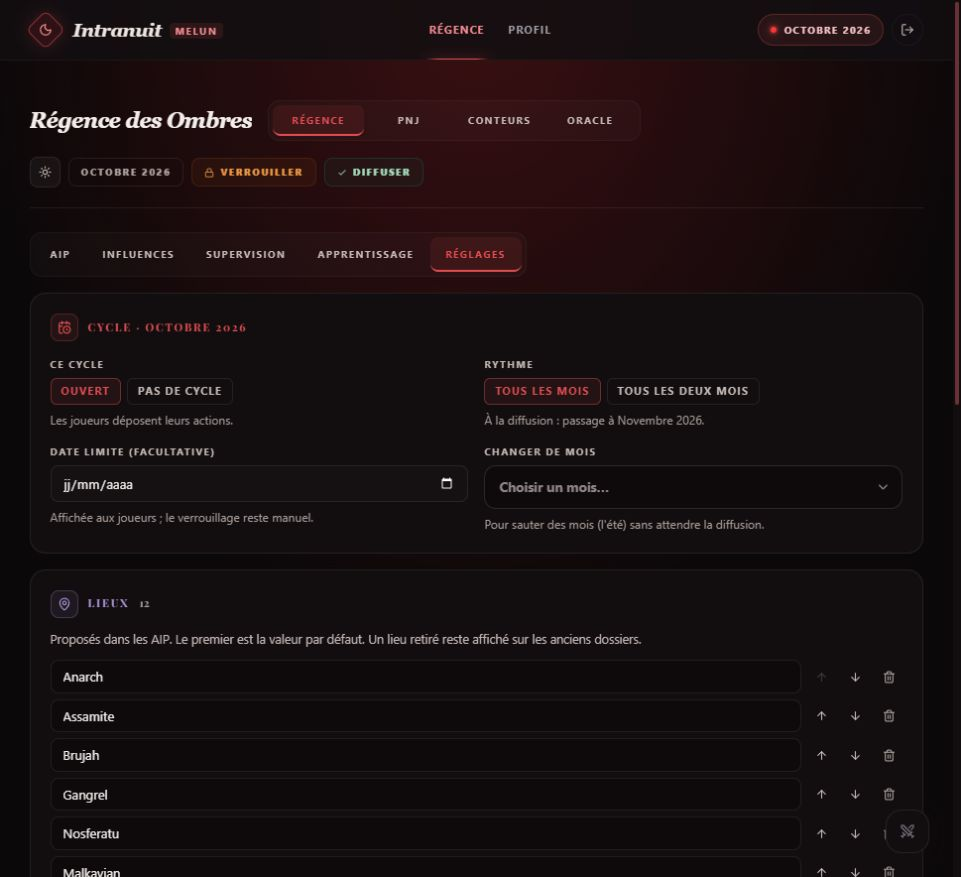

*Figure 11 — Pause, rythme, date limite et listes locales se règlent depuis l’interface.*

## 9 Les résultats et les exports

Après diffusion, les joueurs lisent leurs réponses et leurs tableaux de rumeurs. Le retour d’influences est présenté en cartes Gotha puis Pègre. Les archives d’influences utilisent un tableau dont les lignes se déplient pour lire le détail.

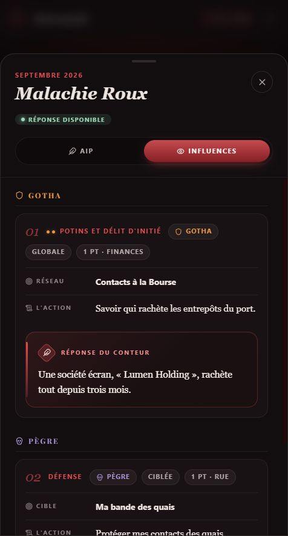

*Figure 12 — Un résultat diffusé, présenté en carte. Les petites pastilles correspondent au niveau requis de l’action globale.*

Les exports Excel permettent de conserver les dossiers par mois **avec leur année**, côté joueur et côté conteur. Les feuilles utiles comprennent les actions, les dépenses et leurs décisions, et les tableaux de rumeurs figés. Les exports AIP conteur incluent les PNJ et leurs bonus. Les archives des PNJ utilisent les actions du cycle historique choisi.

Les exports joueur masquent les réponses et rumeurs tant qu’elles ne sont pas diffusées. Les sources brutes des rumeurs et les notes internes ne sont pas incluses dans les feuilles destinées aux joueurs. Un export Excel ne constitue pas une sauvegarde complète de la base Firebase.

## 10 L’administration et la confidentialité

L’administration valide les inscriptions, attribue les rôles, refuse une demande ou la remet en examen. Elle peut modifier la ville et le nom de la chronique ; le nom Intranuit reste commun. La récupération du mot de passe est proposée à la connexion, depuis le profil et depuis la gestion des comptes.

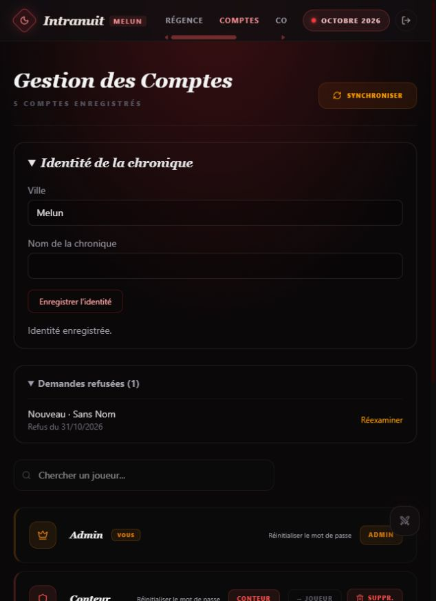

*Figure 13 — L’identité s’adapte à l’association. Les comptes refusés disposent d’une liste séparée.*

La suppression d’un compte bloque son accès et retire son profil ainsi que son entrée d’annuaire. **Ses dossiers de jeu restent conservés pour les archives des conteurs**, avec les AIP, influences, réponses, dépenses et décisions, progressions et liens entre actions, pour tous ses personnages et tous les cycles. Ils restent consultables et exportables côté conteur ; le compte supprimé ne peut plus les lire ni les modifier. **Le compte Firebase Authentication et son adresse e-mail restent présents.** Leur suppression éventuelle exige une intervention distincte dans Firebase.

Les règles Firestore contrôlent l’accès aux dossiers et réservent les décisions sensibles au staff. Les notes internes d’apprentissage sont séparées du suivi joueur. Une rubrique Compte et confidentialité explique l’usage des données dans le profil.

## 11 Le téléphone et le périmètre de la copie

Sur téléphone, la navigation principale passe en bas de l’écran. Sur les écrans plus larges, elle reste en haut. Les tableaux denses disposent d’un défilement horizontal. Une invitation accompagne l’ajout à l’écran d’accueil lorsque le navigateur le permet.

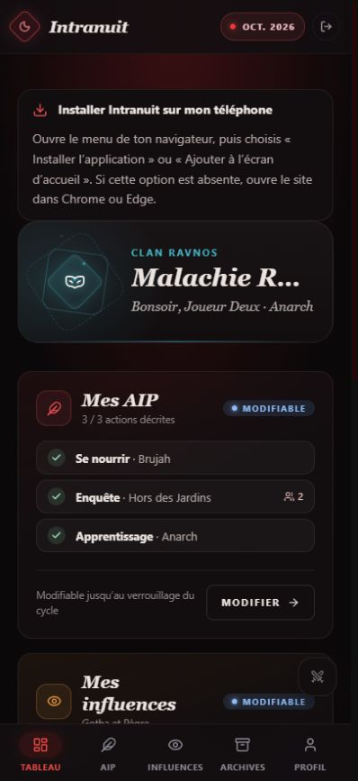

*Figure 14 — L’installation passe par le navigateur et ne nécessite pas de boutique d’applications.*

L’application demande une connexion. Elle n’ajoute pas de cache hors ligne des dossiers et n’envoie pas de notifications push. L’installation native doit encore être vérifiée sur de vrais appareils en HTTPS. Les commandes de couleur et de suppression des conteurs restent à adapter au tactile avant de présenter l’administration mobile comme achevée.

| Fonction | Copie réplicable actuelle |
| --- | --- |
| Comptes, profils, personnages, AIP, influences | Inclus |
| Traitement conteur, PNJ, dépenses, progressions | Inclus |
| Rumeurs, réseaux, cycles, listes, archives, Excel | Inclus |
| Ville et nom de chronique personnalisables | Inclus ; nom Intranuit conservé |
| Oracle et génération IA | Exclus |
| Intrigues et chronologie intégrées à l’Oracle | Exclues avec l’écran Oracle |
| Gestion du contenu de la vitrine d’origine | Exclue |
| Site vitrine et widget d’annonces prêt à installer | Non fournis par cette procédure |
| Brouillon automatique, suivi de solde XP, portefeuille | Absents |
| Notifications push et dossiers accessibles hors connexion | Absents |

Cette séparation repose déjà sur une option de compilation, `VITE_ORIGINAL_INSTANCE=false`. Elle n’exige pas de maintenir deux applications différentes. Le guide porte sur ce socle commun ; il ne promet pas une refonte de l’IA ni une configuration de toutes les règles depuis l’interface.

## 12 Les prérequis avant installation

La suite concerne **une nouvelle instance vide**. Une association choisit ses responsables, un compte GitHub et un projet Firebase qui lui appartiennent. Son hébergement ne partage pas la base ni les comptes de l’instance d’origine.

Deux services se complètent : GitHub Pages sert les fichiers de l’application ; Firebase Authentication gère la connexion et Firestore stocke les données de jeu. Aucun serveur applicatif, Worker IA ou compte de service n’est nécessaire pour le périmètre décrit.

GitHub Pages est disponible avec GitHub Free sur un dépôt public. Le code et son historique sont alors publics ; les dossiers de jeu restent dans Firebase sous contrôle des règles. Un dépôt privé exige une offre GitHub compatible avec Pages. Voir [les conditions de disponibilité de GitHub Pages](https://docs.github.com/en/pages/getting-started-with-github-pages/what-is-github-pages).

Le projet vise le forfait Firebase Spark sans activation de facturation. Les quotas imposent de surveiller l’usage ; le fonctionnement gratuit n’est pas une promesse de capacité illimitée. Vérifier les [quotas Firestore](https://firebase.google.com/docs/firestore/quotas) et les [offres Firebase](https://firebase.google.com/pricing) avant d’ouvrir l’instance.

### Obtenir la distribution destinée au partage

Utiliser le dépôt ou le paquet préparé et autorisé à la diffusion par le propriétaire. **Ne pas publier une copie brute du dépôt de travail ni de son historique.** La préparation doit retirer les secrets, les anciennes clés présentes dans l’historique, les PDF confidentiels FCF, les exports de données, les captures privées et les fichiers propres à l’instance d’origine. Les règles FCF confidentielles ne font pas partie du guide ni du paquet à partager.

Les modalités de réutilisation et de diffusion du code doivent être fournies avec cette distribution. Aucun lien de téléchargement public ni nouvelle licence n’est défini par ce document.

Pour la procédure ci-dessous, nommer le dépôt **intranuit** simplifie la configuration. Le compte GitHub fictif `mon-association` et le projet Firebase fictif `ma-chronique-firebase` sont des exemples à remplacer.

## 13 Créer Firebase

### Étape 1 Créer le projet et l’application Web

1. Ouvrir la [console Firebase](https://console.firebase.google.com/) avec le compte responsable de l’association.
2. Créer un nouveau projet, par exemple `ma-chronique-firebase`. Conserver l’offre Spark ; Analytics est facultatif pour cette installation.
3. Dans les paramètres du projet, ajouter une application **Web** avec l’icône `</>`. Il n’est pas nécessaire d’activer Firebase Hosting puisque les fichiers seront sur GitHub Pages.
4. Conserver les valeurs de configuration Web affichées dans `firebaseConfig`. Elles serviront à la construction.

Le projet Firebase, son application Web et l’identifiant interne Intranuit sont trois choses différentes. La [présentation des projets Firebase](https://firebase.google.com/docs/projects/learn-more) précise cette organisation.

### Étape 2 Activer la connexion par mot de passe

Dans Authentication, ouvrir les méthodes de connexion et activer **E-mail/Mot de passe**. Le mode par lien envoyé par e-mail n’est pas utilisé par ce code. Dans les paramètres de domaines autorisés, ajouter le futur hôte `mon-association.github.io`, sans `https://` et sans `/intranuit/`.

Pour un domaine personnalisé, ajouter aussi ce domaine. Ajouter `localhost` seulement si vous utilisez une prévisualisation locale avec votre vrai Firebase : il n’est plus autorisé par défaut sur les nouveaux projets. Consulter la [configuration de connexion par mot de passe](https://firebase.google.com/docs/auth/web/password-auth) et la [FAQ des domaines autorisés](https://firebase.google.com/docs/auth/faq-and-troubleshooting).

### Étape 3 Créer Firestore et publier les règles

1. Ouvrir Firestore Database et créer la base **Standard**, avec l’identifiant **`(default)`**.
2. Choisir une région adaptée à l’association, par exemple une localisation européenne. Vérifier ce choix avant de créer la base.
3. Choisir le **mode production**, qui ne rend pas les données accessibles librement.
4. Dans l’onglet Règles, remplacer les règles initiales par le contenu intégral du fichier `firestore.rules` fourni avec **la même version** de l’application, puis publier.

Ne pas utiliser des règles ouvertes du type `allow read, write: if true`. Le mot `public` dans certains chemins Intranuit est un nom de structure ; les règles restent déterminantes pour l’accès. La publication depuis la console est décrite dans la [documentation des règles Firestore](https://firebase.google.com/docs/firestore/security/get-started). La création de base est détaillée dans le [démarrage Firestore](https://firebase.google.com/docs/firestore/quickstart).

Les collections seront créées au fil de l’usage. **Ne pas lancer `dev:local` ni le script de fixtures pour initialiser la production** : ils servent à la démonstration avec émulateurs.

## 14 Configurer le dépôt GitHub

### Étape 4 Préparer les fichiers et le chemin du site

Créer votre dépôt à partir de la distribution préparée, avec `package.json`, `package-lock.json`, `src/`, `public/`, `index.html`, `vite.config.js` et `firestore.rules`. La procédure suppose que la branche de publication s’appelle `main`.

Dans `vite.config.js`, le réglage actuel est :

```js
base: '/intranuit/',
```

Il correspond à `https://mon-association.github.io/intranuit/`. Si le dépôt s’appelle `chronique`, remplacer par `'/chronique/'`. Pour un site à la racine d’un domaine personnalisé ou un dépôt `mon-association.github.io`, utiliser `'/'`. Le manifeste utilise des chemins relatifs ; ses icônes restent à livrer avec le site. Voir le [guide Vite pour GitHub Pages](https://vite.dev/guide/static-deploy).

### Étape 5 Renseigner les variables de construction

Dans le dépôt GitHub, ouvrir **Settings → Secrets and variables → Actions → Variables**, puis créer les variables de dépôt suivantes. Les libellés anglais peuvent varier selon la langue de GitHub.

| Variable | Valeur à fournir |
| --- | --- |
| `VITE_FIREBASE_API_KEY` | Champ `apiKey` de votre configuration Web Firebase |
| `VITE_FIREBASE_AUTH_DOMAIN` | Champ `authDomain`, habituellement `votre-projet.firebaseapp.com` |
| `VITE_FIREBASE_PROJECT_ID` | Champ `projectId` de votre projet |
| `VITE_FIREBASE_STORAGE_BUCKET` | Champ `storageBucket`, s’il est fourni ; ne pas inventer son suffixe |
| `VITE_FIREBASE_MESSAGING_SENDER_ID` | Champ `messagingSenderId` |
| `VITE_FIREBASE_APP_ID` | Champ `appId`, souvent sous la forme `1:…:web:…` |
| `VITE_APP_ID` | Identifiant interne stable, par exemple `ma-chronique` ; sans `/` |
| `VITE_INSTANCE_CITY` | Votre ville ; peut être vide |
| `VITE_INSTANCE_CHRONICLE` | Nom de votre chronique ; peut être vide |

`VITE_APP_ID` choisit l’espace de données sous `artifacts/`. Ce n’est **pas** le `appId` Firebase. Le changer après ouverture pointe vers un autre espace : les anciens dossiers ne sont pas déplacés automatiquement.

La configuration Web Firebase est destinée au navigateur ; elle n’est pas une clé d’administration. Les règles Firestore portent le contrôle d’accès. Les variables `VITE_` sont intégrées au JavaScript livré : **ne jamais y placer une clé de compte de service ou une clé secrète de fournisseur IA**. Voir les [explications Firebase sur les clés API](https://firebase.google.com/docs/projects/api-keys).

Les champs Storage et Messaging peuvent apparaître dans la configuration Web sans que l’application nécessite l’activation de Storage ou des notifications. Ville et nom servent de valeurs initiales ; l’identité enregistrée ensuite par un administrateur dans l’application les remplace.

### Étape 6 Ajouter le workflow et activer Pages

Dans votre dépôt de destination, créer `.github/workflows/deploy-pages.yml` avec le contenu de l’exemple ci-dessous. Le fichier `deploy-pages.yml.example` accompagne aussi ce guide. Il force la variante réplicable et désactive les émulateurs lors de la compilation. Si votre branche porte un autre nom, adapter `branches: [main]`.

```yaml
# Exemple documentaire : copier dans .github/workflows/deploy-pages.yml
# sur le dépôt préparé de la nouvelle association. Rien n'est activé ici.
name: Publier Intranuit

on:
  workflow_dispatch:
  push:
    branches: [main]

permissions:
  contents: read

concurrency:
  group: pages
  cancel-in-progress: false

jobs:
  build:
    runs-on: ubuntu-latest
    env:
      VITE_FIREBASE_API_KEY: ${{ vars.VITE_FIREBASE_API_KEY }}
      VITE_FIREBASE_AUTH_DOMAIN: ${{ vars.VITE_FIREBASE_AUTH_DOMAIN }}
      VITE_FIREBASE_PROJECT_ID: ${{ vars.VITE_FIREBASE_PROJECT_ID }}
      VITE_FIREBASE_STORAGE_BUCKET: ${{ vars.VITE_FIREBASE_STORAGE_BUCKET }}
      VITE_FIREBASE_MESSAGING_SENDER_ID: ${{ vars.VITE_FIREBASE_MESSAGING_SENDER_ID }}
      VITE_FIREBASE_APP_ID: ${{ vars.VITE_FIREBASE_APP_ID }}
      VITE_APP_ID: ${{ vars.VITE_APP_ID }}
      VITE_INSTANCE_CITY: ${{ vars.VITE_INSTANCE_CITY }}
      VITE_INSTANCE_CHRONICLE: ${{ vars.VITE_INSTANCE_CHRONICLE }}
      VITE_ORIGINAL_INSTANCE: 'false'
      VITE_USE_EMULATORS: 'false'
    steps:
      - uses: actions/checkout@v6
      - uses: actions/setup-node@v6
        with:
          node-version: '22'
          cache: npm
      - name: Installer les dépendances
        run: npm ci
      - name: Vérifier les valeurs indispensables
        shell: bash
        run: |
          for key in VITE_FIREBASE_API_KEY VITE_FIREBASE_AUTH_DOMAIN VITE_FIREBASE_PROJECT_ID VITE_FIREBASE_APP_ID VITE_APP_ID; do
            if [ -z "${!key}" ]; then
              echo "Variable manquante : $key"
              exit 1
            fi
          done
      - name: Construire
        run: npm run build
      - uses: actions/configure-pages@v5
      - uses: actions/upload-pages-artifact@v4
        with:
          path: dist

  deploy:
    needs: build
    runs-on: ubuntu-latest
    permissions:
      pages: write
      id-token: write
    environment:
      name: github-pages
      url: ${{ steps.deployment.outputs.page_url }}
    steps:
      - name: Publier
        id: deployment
        uses: actions/deploy-pages@v4
```

Dans **Settings → Pages → Build and deployment**, choisir **GitHub Actions** comme source. Autoriser les actions officielles utilisées si la politique de l’organisation les bloque. Le workflow construit `dist/`, puis le publie ; il **ne publie pas les règles Firebase** et ne demande aucun compte de service Firebase. Voir la [configuration des workflows Pages](https://docs.github.com/en/pages/getting-started-with-github-pages/using-custom-workflows-with-github-pages).

Dans l’onglet **Actions**, lancer « Publier Intranuit » avec **Run workflow**, ou déclencher la publication en enregistrant un changement sur `main`. Attendre la réussite des tâches `build` et `deploy`, puis ouvrir l’URL affichée par le déploiement. Les modifications ultérieures des variables nécessitent une nouvelle construction.

## 15 Créer le premier administrateur

### Étape 7 S’inscrire puis attribuer le premier rôle

1. Sur le nouveau site publié, choisir **Rejoindre le cercle** et créer le compte de la personne qui administrera la chronique. Utiliser ses propres informations ; les comptes de démonstration du développeur ne sont pas transférés.
2. Vérifier l’apparition de l’écran d’attente. Ce comportement est normal : personne ne devient administrateur par simple inscription.
3. Dans Firebase **Authentication → Users**, retrouver cette adresse et copier son **UID**.
4. Dans Firestore **Données**, ouvrir `artifacts`, puis le document correspondant à votre `VITE_APP_ID`, puis `users`, puis le document correspondant à cet UID, puis `profile`, puis `info`.
5. Dans ce document existant, modifier seulement le champ chaîne `role` : remplacer `pending` par **`admin`**. Conserver les autres champs du profil.
6. Actualiser le site ou se reconnecter. L’onglet **Comptes** doit apparaître ; le miroir du profil est resynchronisé à la connexion.

Exemple de chemin avec un identifiant interne fictif :

```text
artifacts/ma-chronique/users/UID_DU_COMPTE/profile/info
```

Cette opération s’effectue avec le compte propriétaire du projet dans la console Firebase. Elle ne nécessite pas d’assouplir les règles ni de modifier le code pour autoriser une auto-promotion.

Le premier accès staff initialise le document du cycle s’il n’existe pas. Vérifier le mois dans **Régence → Réglages**. Les lieux et types d’AIP prennent leurs valeurs par défaut jusqu’à leur personnalisation.

### Étape 8 Préparer votre chronique

Dans **Comptes**, renseigner la ville et le nom de la chronique. Valider les autres inscriptions et donner le rôle Conteur aux membres de l’équipe. Dans **Régence → Conteurs**, créer les identités utilisées pour les attributions ; cette liste d’attribution est distincte des permissions du compte connecté.

Adapter les lieux et types d’AIP, choisir le rythme et la date limite, puis créer les PNJ et les réseaux utiles. Vérifier leur visibilité avant de commencer. Le bouton Synchroniser sert à récupérer d’anciennes entrées de dossiers ; une installation neuve n’en a normalement pas besoin.

## 16 Vérifier avant d’inviter les joueurs

Effectuer ce parcours avec deux comptes de test créés sur **votre nouvelle instance**, en indiquant clairement leur usage à l’équipe :

- [ ] La page et les icônes se chargent depuis l’URL finale en HTTPS.
- [ ] Les écrans Oracle, Intrigues/Chronologie de l’Oracle et Contenu ne sont pas proposés dans la copie.
- [ ] Une nouvelle inscription reste en attente jusqu’à la validation admin.
- [ ] Le joueur A peut déposer une AIP et une influence, puis les modifier avant verrouillage.
- [ ] Le joueur B retrouve son propre dossier sans voir celui du joueur A.
- [ ] Le conteur voit les deux dossiers et peut s’attribuer une action puis y répondre.
- [ ] Une dépense peut être validée ou refusée avec un motif ; le suivi joueur correspond à la décision.
- [ ] Une demande de progression arrive dans la file ; les notes internes restent absentes du suivi joueur.
- [ ] Le verrouillage rend le dossier joueur consultable et bloque sa modification.
- [ ] La diffusion rend le résultat visible et avance le cycle attendu ; vérifier cela sur un cycle de test préparé pour cet usage.
- [ ] L’export Excel du mois porte la bonne année et contient les feuilles attendues.
- [ ] Un vrai mail de réinitialisation arrive et le lien permet le changement de mot de passe du compte de test.
- [ ] L’ajout à l’écran d’accueil est essayé sur un téléphone réel ; connexion et lecture des résultats restent utilisables.

Cette recette d’installation reste à exécuter sur un nouveau projet hébergé. Après adaptation de la suppression de compte pour conserver les archives, les vérifications locales du 31 octobre 2026 donnent **143 tests unitaires et 48 tests Firestore réussis**, ainsi qu’une compilation d’origine réussie. Les trois anciens tests de purge des dossiers ont été retirés ; le test intégré contrôle désormais leur conservation, les exports et les restrictions d’accès. La compilation réplicable avait également réussi avant ce changement commun aux deux variantes. Ces vérifications ne remplacent pas les essais d’e-mail et de téléphone ci-dessus.

## 17 Mettre à jour et résoudre les problèmes courants

### Les mises à jour

Conserver une copie de la version utilisée et des règles associées avant une mise à jour. Examiner les changements et les éventuelles consignes de migration, publier les règles de la version dans Firebase puis publier le code compatible par GitHub Actions. Sur une base existante, l’ordre exact doit être adapté aux changements annoncés ; ne pas remplacer des règles personnalisées sans comparaison.

GitHub conserve le code ; Firebase conserve les comptes et dossiers. Une restauration du site ne restaure pas la base. Organiser séparément la sauvegarde des données selon les possibilités du forfait choisi. Ne pas considérer les exports Excel comme une restauration complète de la chronique.

### Diagnostic rapide

| Symptôme | Vérification utile |
| --- | --- |
| Page blanche ou fichiers CSS/JS introuvables | Vérifier `base` dans `vite.config.js`, le nom du dépôt et le déploiement de `dist/`. |
| Le workflow s’arrête pour une variable manquante | Vérifier les variables de dépôt Actions, leur orthographe et leur valeur, puis relancer. |
| Connexion impossible | Vérifier les valeurs Firebase, l’activation E-mail/Mot de passe et les domaines autorisés. |
| Le premier compte reste en attente | Vérifier `role: admin` dans le profil privé du bon UID et du bon `VITE_APP_ID`, puis se reconnecter. |
| Permission refusée sur les dossiers | Vérifier les règles de la version, le rôle, le cycle et le statut du dossier. Ne pas ouvrir les règles pour contourner l’erreur. |
| L’instance semble vide après une mise à jour | Vérifier `VITE_FIREBASE_PROJECT_ID` et `VITE_APP_ID` ; ne pas recréer les données avant d’avoir confirmé la cible. |
| Le navigateur tente d’atteindre 127.0.0.1 | Vérifier que `VITE_USE_EMULATORS` vaut `false` au build et republier. |
| Oracle est encore visible | Vérifier que le build utilise `VITE_ORIGINAL_INSTANCE=false`, puis reconstruire. |
| Le mail n’arrive pas | Vérifier l’adresse, les indésirables, les modèles et les quotas Authentication ; le message générique de récupération ne confirme pas l’existence d’un compte. |
| Plus aucune écriture ou lecture ne fonctionne | Consulter les erreurs et l’usage Firebase pour distinguer permissions, connexion et quota atteint. |

### Repères pour une personne qui accompagne l’installation

Le front utilise React et Vite ; les données et permissions utilisent Firebase Authentication et Firestore. La configuration est intégrée à la compilation, sans fichier `config.json` modifiable à chaud. Le site publié n’utilise pas de serveur Node à l’exécution.

Un contrôle local facultatif, pour une personne équipée de Node 22, consiste à copier `.env.example` vers `.env.local`, renseigner les valeurs de sa propre instance et conserver `VITE_ORIGINAL_INSTANCE=false` et `VITE_USE_EMULATORS=false`, puis exécuter `npm ci`, `npm run build` et `npm run preview`. Cette prévisualisation contacte le Firebase configuré ; ce n’est pas un bac à sable. Le parcours GitHub Actions décrit plus haut évite d’installer Node sur le poste de l’association.

## 18 Références et entretien du guide

Les liens officiels des étapes d’installation ont été consultés le 31 octobre 2026. Les intitulés des consoles, les versions d’actions et les offres peuvent évoluer ; les vérifier lors de la première installation et des mises à jour importantes.

- [GitHub Pages et disponibilité selon les offres](https://docs.github.com/en/pages/getting-started-with-github-pages/what-is-github-pages)
- [Workflows personnalisés de GitHub Pages](https://docs.github.com/en/pages/getting-started-with-github-pages/using-custom-workflows-with-github-pages)
- [Déploiement Vite sur un hébergement statique](https://vite.dev/guide/static-deploy)
- [Organisation des projets Firebase](https://firebase.google.com/docs/projects/learn-more)
- [Démarrage de Firestore](https://firebase.google.com/docs/firestore/quickstart)
- [Publication des règles Firestore](https://firebase.google.com/docs/firestore/security/get-started)
- [Connexion Firebase par mot de passe](https://firebase.google.com/docs/auth/web/password-auth)
- [FAQ Authentication et domaines autorisés](https://firebase.google.com/docs/auth/faq-and-troubleshooting)
- [Clés de configuration Firebase](https://firebase.google.com/docs/projects/api-keys)
- [Quotas Firestore](https://firebase.google.com/docs/firestore/quotas)
- [Offres Firebase](https://firebase.google.com/pricing)

Les captures proviennent de la démonstration locale et des recettes des 30 et 31 octobre 2026. Aucun compte de production, secret, export de base ou PDF de règles confidentiel n’est inclus. Ce guide décrit un outil d’aide à la gestion d’une chronique ; les arbitrages des conteurs restent nécessaires.
